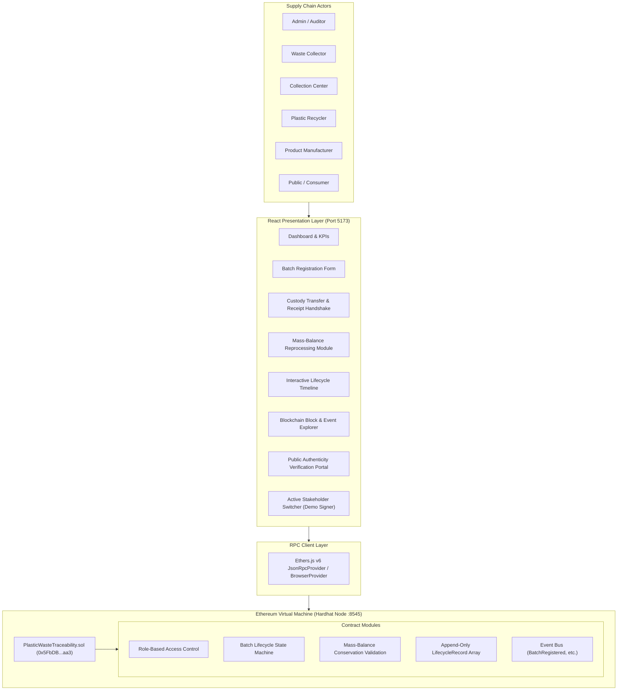

# PlasticTrace — Blockchain-Based Plastic Waste Traceability System

[](https://soliditylang.org/)
[](https://hardhat.org/)
[](https://react.dev/)
[](https://docs.ethers.org/v6/)
[](LICENSE)

**Full Project Title:** Blockchain-Based Plastic Waste Traceability System  
**Academic Domain:** Waste Management, Environmental Sustainability, and Distributed Ledger Technology (DLT)  
**Target Audience:** Academic Viva, Technical Demonstration, Project Presentation, and Case Study

---

## 1. Abstract

Global plastic recycling supply chains suffer from fragmented records, opacity, and widespread skepticism regarding recycled content claims ("greenwashing"). Conventional centralized databases are vulnerable to retroactive tampering, accidental record overwrites, and single-point-of-failure administration. 

**PlasticTrace** is an end-to-end decentralized application (dApp) that establishes an immutable, single source of truth across the plastic recycling lifecycle. By deploying an EVM-compatible Solidity smart contract (`PlasticWasteTraceability.sol`), every plastic lot is assigned a unique Batch ID. Cryptographically signed transactions govern each custodial handover—from waste collectors to sorting centers, mechanical recyclers, and consumer brand manufacturers. Furthermore, the smart contract mathematically enforces a **mass-balance conservation equation** at recycling facilities ($\text{Quantity Processed} = \text{Recycled Output} + \text{Residual Waste}$) to prevent fraudulent secondary material claims. The platform includes a responsive, light-themed sustainability dashboard with live on-chain KPIs, interactive batch tracking, a blockchain explorer, and a public provenance verification portal.

---

## 2. Problem Statement

Plastic waste flows through multiple loosely coordinated stakeholders: informal/formal waste collectors, aggregation centers, sorting plants, mechanical/chemical recyclers, and product manufacturers.

In traditional recycling workflows:
- **Fragmented Data Silos:** Each stakeholder logs weights and transfers in private spreadsheets or proprietary ERPs, making cross-supply-chain tracing difficult.
- **Inconsistent Discrepancies:** Shipped quantities frequently differ from received quantities due to moisture loss, sorting loss, or inaccurate scales, leading to untracked loss disputes.
- **Vulnerability to Tampering:** Centrally maintained records can be altered retroactively to inflate recycled-content quotas or pass regulatory environmental audits.
- **Greenwashing & Lack of Transparency:** Consumers and ESG auditors cannot independently verify whether a plastic bottle actually contains certified post-consumer recycled (PCR) resin.

---

## 3. Project Objectives

1. **Decentralized Chain of Custody:** Implement an on-chain state machine where custody can only be transferred with an explicit two-phase cryptographic handshake (Dispatch $\rightarrow$ Receipt Confirmation).
2. **Access Control & Non-Repudiation:** Enforce smart-contract role permissions so only authorized collectors register batches, only current custodians initiate transfers, and only authorized recyclers record reprocessing.
3. **Mass-Balance Conservation:** Mathematically validate on-chain that reprocessing output plus non-recyclable residue strictly equals total processed mass.
4. **Transparent Audit Trail:** Provide a public explorer and timeline where anyone can audit block numbers, transaction hashes, timestamps, and physical batch locations.
5. **Zero External Cost & Academic Defensibility:** Operate entirely on a local Hardhat blockchain requiring no testnet faucets, no paid gas, and no complex external databases.

---

## 4. Existing System vs. Proposed System

| Dimension | Conventional Recycling Systems | PlasticTrace Blockchain System |
| :--- | :--- | :--- |
| **Data Storage** | Centralized SQL/NoSQL databases or Excel sheets | Decentralized Ethereum Virtual Machine (EVM) ledger |
| **Custody Handover** | Paper waybills, verbal confirmation, email | Smart-contract two-phase handshake with event logs |
| **Data Integrity** | Vulnerable to admin alteration, deletion, or backdating | Append-only, cryptographically hashed, immutable |
| **Mass-Balance Audit** | Manual self-reported spreadsheets | Programmatically enforced in Solidity bytecode |
| **Public Verification** | Trust in third-party paper certificates | Direct query of smart-contract state via Batch ID |
| **Single Point of Failure** | Central server / IT department | Distributed network of validating nodes |

---

## 5. Why Blockchain is Appropriate

1. **Multi-Party Non-Trust Environment:** Collectors, municipal hubs, recyclers, and brand owners often have conflicting commercial incentives. A blockchain eliminates the need to trust any single party's server.
2. **Tamper-Evident Chronology:** Once a block is mined, timestamps and actor signatures cannot be altered to satisfy retroactive audit demands.
3. **Cryptographic Identity:** Every lifecycle claim is signed by a private key, ensuring non-repudiation during supply chain disputes.
4. **Physical Verification Boundary (Viva Distinction):** Blockchain guarantees **data and record integrity**, not physical reality. The smart contract guarantees that claims cannot be altered; physical IoT sensors, weighbridge calibrations, and laboratory resin tests verify real-world material properties.

---

## 6. Real-World Precedents

To ground this academic project in current industrial context:
- **IBM & Plastic Bank:** Deployed private blockchain infrastructure on IBM LinuxONE to track ocean-bound plastic in developing regions, rewarding local collectors with digital tokens redeemable for basic necessities. [Read IBM Case Study](https://www.ibm.com/case-studies/plastic-bank-systems-linuxone).
- **Asahi Kasei & BLUE Plastics Trial:** An industrial consortium in Japan using digital product passports and blockchain to certify recycled plastic content across automotive and packaging supply chains. [Read Asahi Kasei Release](https://www.asahi-kasei.com/news/2022/e220706).

---

## 7. UN Sustainable Development Goal (SDG) Alignment

- **SDG 12: Responsible Consumption and Production (Primary Focus):** Target 12.5 aims to substantially reduce waste generation through prevention, reduction, recycling, and reuse. PlasticTrace provides verified tracking of secondary polymers, helping manufacturers legitimately meet recycled packaging mandates.
- **SDG 11: Sustainable Cities and Communities (Primary Focus):** Target 11.6 focuses on reducing the environmental impact of cities through sound municipal solid waste management.
- **SDG 13 & SDG 14 (Indirect Benefits):** Diverting plastic from landfills and waterways indirectly mitigates greenhouse gas emissions and marine plastic debris.

---

## 8. Technology Stack

- **Smart Contract Language:** Solidity `^0.8.24` (EVM target: Paris)
- **Local Blockchain & Testing:** Hardhat `v2.22.18`, `@nomicfoundation/hardhat-toolbox`
- **Frontend Framework:** React 18 (Vite 5, JavaScript, Plain CSS)
- **Web3 Client Integration:** Ethers.js `v6.13.5` (JSON-RPC Provider & Browser Signer)
- **Icons & UI:** Lucide React, CSS Variables (sustainability theme: emerald, teal, navy)
- **Node Environment:** Node.js LTS, npm

---

## 9. System Architecture



---

## 10. End-to-End Batch Lifecycle Workflow

```mermaid
sequenceDiagram
    autonumber
    actor Collector as Waste Collector
    actor Center as Collection Center
    actor Recycler as Recycling Facility
    actor Mfg as Manufacturer
    participant Contract as PlasticWasteTraceability.sol

    Note over Collector, Contract: 1. Registration
    Collector->>Contract: registerBatch("PL-1001", "PET", 100 kg, "Vijayawada Center")
    Contract-->>Contract: Validate role, unique ID, qty > 0
    Contract-->>Collector: Emits BatchRegistered (Status: Registered)

    Note over Collector, Center: 2. Dispatch to Sorting Hub
    Collector->>Contract: initiateTransfer("PL-1001", Center, 100 kg, "Route A", "Dispatched")
    Contract-->>Contract: Validate caller == custodian; Status -> InTransit

    Note over Center, Contract: 3. Receipt Handshake
    Center->>Contract: confirmReceipt("PL-1001", "EcoSorting Hub", "Baled & inspected")
    Contract-->>Contract: Custodian updated to Center; Status -> Received

    Note over Center, Recycler: 4. Transfer to Recycler
    Center->>Contract: initiateTransfer("PL-1001", Recycler, 100 kg, "Route B", "Sent to plant")
    Recycler->>Contract: confirmReceipt("PL-1001", "PureCycle Bay 2", "Accepted for reprocessing")

    Note over Recycler, Contract: 5. Reprocessing & Mass-Balance
    Recycler->>Contract: recordProcessing("PL-1001", 100 kg, 80 kg rPET, 20 kg residual, "Extrusion Line 1")
    Contract-->>Contract: Verify 100 kg == 80 kg + 20 kg; Status -> Processed

    Note over Recycler, Mfg: 6. Delivery of Secondary Pellets to Manufacturer
    Recycler->>Contract: initiateTransfer("PL-1001", Mfg, 80 kg, "Highway 16", "rPET pellets")
    Mfg->>Contract: confirmReceipt("PL-1001", "EcoPackaging Factory", "Accepted for bottle manufacturing")
    Contract-->>Contract: Status -> Completed (End of Lifecycle)
```

---

## 11. Smart Contract Architecture

The primary contract is **`PlasticWasteTraceability.sol`** located in `blockchain/contracts/`.

### Key Data Structures

```solidity
enum Role { None, Admin, Collector, CollectionCenter, Recycler, Manufacturer }
enum BatchStatus { Registered, InTransit, Received, Processed, Completed }
enum EventType { Registration, TransferInitiated, ReceiptConfirmed, ProcessingRecorded, Completed }

struct LifecycleRecord {
    EventType eventType;
    address actor;
    address recipient;
    uint256 quantity;
    uint256 timestamp;
    string location;
    string notes;
    string details;
}

struct Batch {
    string batchId;
    string plasticType;
    uint256 initialQuantity;
    uint256 currentQuantity;
    uint256 recycledOutput;
    uint256 residualWaste;
    string collectionLocation;
    address collector;
    address currentCustodian;
    address pendingRecipient;
    BatchStatus status;
    uint256 registrationTimestamp;
    uint256 lastUpdatedTimestamp;
    bool exists;
}
```

### Core Functions & Validations

1. `registerBatch(batchId, plasticType, quantity, location)`: Only authorized Collectors or Admin can call. Enforces ID uniqueness and quantity $> 0$.
2. `initiateTransfer(batchId, recipient, quantity, location, notes)`: Caller must be `currentCustodian`. Validates recipient is authorized stakeholder. Transitions status to `InTransit`.
3. `confirmReceipt(batchId, location, notes)`: Caller must strictly be the designated `pendingRecipient`. Updates custodian and transitions status to `Received` (or `Completed` if recipient is Manufacturer).
4. `recordProcessing(batchId, quantityProcessed, recycledOutput, residualWaste, location, notes)`: Authorized Recycler only. Caller must be current custodian. Enforces strict conservation equation:
   $$\text{quantityProcessed} == \text{recycledOutput} + \text{residualWaste}$$
5. `getBatch(batchId)` & `getBatchHistory(batchId)`: External view functions returning immutable batch details and the array of lifecycle events.
6. `getSystemMetrics()`: Computes network-wide aggregation of batches, inputs, in-transit counts, and recycled outputs.

---

## 12. Preconfigured Stakeholder Accounts (Hardhat Testnet)

For demonstration and viva presentation, PlasticTrace maps the standard deterministic Hardhat accounts to supply chain personas:

| Account | Persona | Address | Role | Description |
| :--- | :--- | :--- | :--- | :--- |
| **#0** | **System Admin / Auditor** | `0xf39Fd6e51aad88F6F4ce6aB8827279cffFb92266` | `Admin` | Deploys contract, assigns stakeholder roles |
| **#1** | **GreenCollect Services** | `0x70997970C51812dc3A010C7d01b50e0d17dc79C8` | `Collector` | Aggregates and registers raw plastic waste |
| **#2** | **City EcoSorting Hub** | `0x3C44CdDdB6a900fa2b585dd299e03d12FA4293BC` | `CollectionCenter` | Sorts, bales, and transfers plastic |
| **#3** | **PureCycle Polymers** | `0x90F79bf6EB2c4f870365E785982E1f101E93b906` | `Recycler` | Mechanical reprocessing, mass-balance |
| **#4** | **EcoPackaging Ltd** | `0x15d34AAf54267DB7D7c367839AAf71A00a2C6A65` | `Manufacturer` | Produces secondary goods / packaging |
| **#5** | **Public / Unauthorized** | `0x9965507D1a55bcC2695C58ba16FB37d819B0A4dc` | `None` | Used to demonstrate on-chain access rejection |

---

## 13. Installation & Setup Guide

### Prerequisites
- Node.js (v18, v20, or v22 LTS)
- npm (v9+)
- Web browser (Chrome, Edge, Firefox, Brave)

### Step 1: Install Dependencies
Open a terminal in the root directory:

```bash
# Install blockchain dependencies
cd blockchain
npm install

# Install frontend dependencies
cd ../frontend
npm install
```

---

## 14. Running the Complete System

### Step 1: Start the Local Hardhat Blockchain
In Terminal 1:
```bash
cd blockchain
npx hardhat node
```
*Leave this terminal running. It starts a local Ethereum node on `http://127.0.0.1:8545` with 20 funded accounts.*

### Step 2: Deploy the Smart Contract
In Terminal 2:
```bash
cd blockchain
npm run deploy
```
*Output: Deploys `PlasticWasteTraceability.sol`, assigns stakeholder roles on-chain, and exports configuration to `frontend/src/contracts/contractData.json`.*

### Step 3: (Optional) Seed the Demonstration Scenario
In Terminal 2:
```bash
npm run seed
```
*This executes the complete PET batch `PL-1001` walkthrough and seeds additional batches on the local blockchain.*

### Step 4: Start the Frontend Application
In Terminal 2:
```bash
cd ../frontend
npm run dev
```
*Open your browser at `http://localhost:5173/`.*

---

## 15. MetaMask Configuration (Optional)

If you prefer signing with MetaMask rather than the built-in persona switcher:
1. Open MetaMask $\rightarrow$ Networks $\rightarrow$ **Add Network Manually**.
2. **Network Name:** `Hardhat Localhost`
3. **New RPC URL:** `http://127.0.0.1:8545`
4. **Chain ID:** `31337`
5. **Currency Symbol:** `ETH`
6. Click **Save**.
7. Import test accounts using their private keys (e.g. Account #1 Collector: `0x59c6995e998f97a5a0044966f0945389dc9e86dae88c7a8412f4603b6b78690d`).

---

## 16. Automated Smart Contract Tests

PlasticTrace includes **23 automated tests** verifying all business rules, access controls, and mass-balance calculations.

To execute tests:
```bash
cd blockchain
npx hardhat test
```

### Test Coverage Highlights
```text
  PlasticWasteTraceability Smart Contract
    1. Stakeholder Role Management & Access Control
      ✓ Should correctly set admin on deployment
      ✓ Should allow admin to assign stakeholder roles and emit StakeholderRoleUpdated
      ✓ Should reject role assignment by non-admin accounts
      ✓ Should reject role assignment for the zero address
    2. Batch Registration
      ✓ Should allow an authorized collector to register a new plastic batch and emit BatchRegistered
      ✓ Should reject registration with duplicate Batch ID
      ✓ Should reject registration from unauthorized stakeholders
      ✓ Should reject registration with empty Batch ID or zero quantity
    3. Batch Transfer & Custody Handover
      ✓ Should allow current custodian to initiate transfer and put batch in InTransit status
      ✓ Should reject transfer if caller is not current custodian
      ✓ Should reject transfer to unauthorized recipient or invalid role sequence
      ✓ Should reject transfer when batch is already InTransit
      ✓ Should reject transfer quantity exceeding current batch quantity
    4. Receipt Confirmation
      ✓ Should allow designated recipient to confirm receipt and update custodian
      ✓ Should reject receipt confirmation by unauthorized stakeholder or wrong recipient
      ✓ Should reject receipt confirmation when batch is not InTransit
    5. Plastic Processing & Recycling Mass Balance
      ✓ Should allow authorized recycler to record processing with valid mass-balance
      ✓ Should reject processing if mass balance is violated (output + residual != processed)
      ✓ Should reject processing if quantity exceeds available batch quantity
      ✓ Should reject processing by unauthorized non-recycler
    6. Batch History & System Metrics
      ✓ Should maintain an immutable chronological audit trail of all lifecycle events
      ✓ Should accurately compute global system metrics across multiple batches
      ✓ Should list all registered batch IDs

  23 passing
```

---

## 17. End-to-End Live Demonstration Script

Follow this sequence during your academic evaluation:

1. **Dashboard Overview:** Show live on-chain KPIs (Total Batches, Collected Input, In Transit, Recycled Output, Reprocessing Yield).
2. **Register Batch `PL-2001`:**
   - Active Persona: Collector (Account #1).
   - Enter Batch ID: `PL-2001`, Resin: `PET`, Quantity: `100 kg`, Location: `Vijayawada Collection Center`.
   - Click **Register Batch On-Chain**. Show the transaction hash and block number.
3. **Demonstrate Duplicate Rejection (Invalid Op 1):**
   - Attempt to register `PL-2001` again.
   - The contract reverts: `"PlasticTrace: Batch ID already exists"`.
4. **Demonstrate Unauthorized Registration (Invalid Op 2):**
   - Click top-right persona switcher $\rightarrow$ Select **Public / Unauthorized** (Account #5).
   - Attempt to register batch. The contract reverts: `"PlasticTrace: Caller is not an authorized Collector"`.
5. **Initiate Transfer:**
   - Switch back to Collector. Go to **Transfer & Receive** $\rightarrow$ Transfer `PL-2001` to `City EcoSorting Hub` (Account #2).
   - Status changes to `InTransit`.
6. **Confirm Receipt:**
   - Switch persona to **City EcoSorting Hub** (Account #2).
   - Go to **Confirm Receipt** $\rightarrow$ Click **Accept Custody On-Chain**. Status updates to `Received`.
7. **Transfer to Recycler:**
   - Transfer `PL-2001` from Collection Center to `PureCycle Polymers` (Account #3).
   - Switch persona to Recycler and confirm receipt.
8. **Reprocessing with Mass Balance:**
   - Go to **Process Plastic** as Recycler.
   - Process 100 kg with 80 kg recycled output + 20 kg residual waste.
   - Show how the live mass-balance equation verifies conservation of mass before mining.
   - Click **Record Processing On-Chain**.
9. **Inspect Batch Tracking:**
   - Go to **Batch Tracking** $\rightarrow$ Search `PL-2001`.
   - Walk through the visual chronological timeline displaying each step, actor address, and transaction hash.
10. **Public Verification:**
    - Go to **Public Verification** $\rightarrow$ Search `PL-2001`.
    - Display the cryptographic verification certificate seal and explain the distinction between record integrity and physical inspection.

---

## 18. Limitations and Future Enhancements

- **Physical-Digital Gap ("Oracle Problem"):** In production environments, integrate IoT-connected weighbridges, automated camera resin classifiers, and RFID/barcode tagging to verify physical shipments automatically.
- **Zero-Knowledge Proofs (ZKPs):** Implement ZK-SNARKs to allow recyclers to prove compliance with mass-balance conservation without revealing sensitive commercial pricing or proprietary supplier names.
- **Decentralized Storage (IPFS):** Store laboratory quality analysis certificates, moisture test PDFs, and photos of bales on IPFS with hashes recorded on-chain.

---

## 19. Project Structure

```text
PlasticTrace/
├── blockchain/
│   ├── contracts/
│   │   └── PlasticWasteTraceability.sol   # Core Solidity Smart Contract
│   ├── scripts/
│   │   ├── deploy.js                      # Deployment & Role Authorization Script
│   │   └── seed.js                        # Demo Scenario Preloader Script
│   ├── test/
│   │   └── PlasticWasteTraceability.test.js # 23 Automated Mocha/Chai Unit Tests
│   ├── hardhat.config.js                  # Hardhat EVM Configuration
│   └── package.json
├── frontend/
│   ├── src/
│   │   ├── components/
│   │   │   ├── Header.jsx                 # Top bar, Persona Badge, Refresh
│   │   │   ├── Sidebar.jsx                # Navigation menu
│   │   │   ├── RoleSwitcherModal.jsx      # Hardhat Persona & MetaMask Switcher
│   │   │   └── TransactionFeedback.jsx    # On-chain tx receipt banner
│   │   ├── pages/
│   │   │   ├── Dashboard.jsx              # KPIs, charts, recent batches
│   │   │   ├── RegisterBatch.jsx          # Batch registration form
│   │   │   ├── BatchTracking.jsx          # Search & chronological timeline
│   │   │   ├── TransferReceive.jsx        # Handshake transfer & receipt tabs
│   │   │   ├── ProcessPlastic.jsx         # Mass-balance recycling calculator
│   │   │   ├── BlockchainExplorer.jsx     # Blocks, events, and raw logs
│   │   │   ├── PublicVerification.jsx     # Consumer verification certificate
│   │   │   └── AboutProject.jsx           # Viva guide, SDG alignment, references
│   │   ├── services/
│   │   │   └── blockchain.js              # Ethers.js client & account config
│   │   ├── contracts/
│   │   │   └── contractData.json          # Exported ABI & contract address
│   │   ├── styles/
│   │   │   └── index.css                  # Clean sustainability UI styles
│   │   ├── App.jsx                        # Main state and router
│   │   └── main.jsx
│   ├── index.html
│   ├── vite.config.js
│   └── package.json
├── docs/
│   ├── architecture.md                    # System architecture & data model
│   └── diagrams.md                        # Mermaid sequence & state diagrams
├── .gitignore
├── package.json                           # Root convenience scripts
└── README.md                              # Complete academic documentation
```

---

## 20. License & Academic Disclaimer

This project is licensed under the **MIT License**. It is an academic prototype developed for educational demonstration, viva defense, and environmental traceability research. Smart contracts are intended for deployment on local development EVM networks or testnets.
