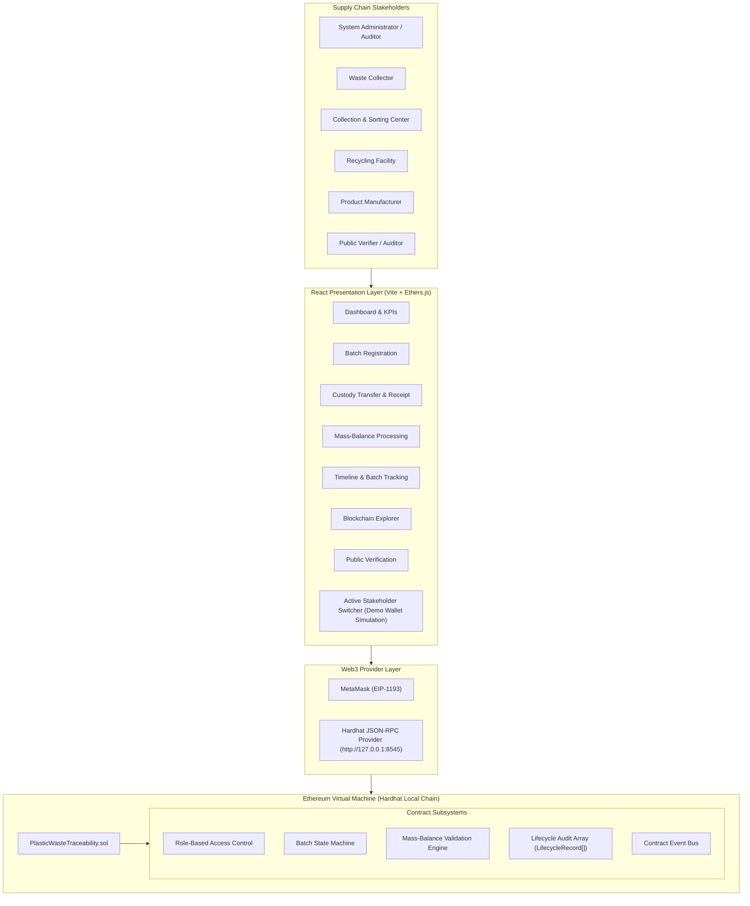
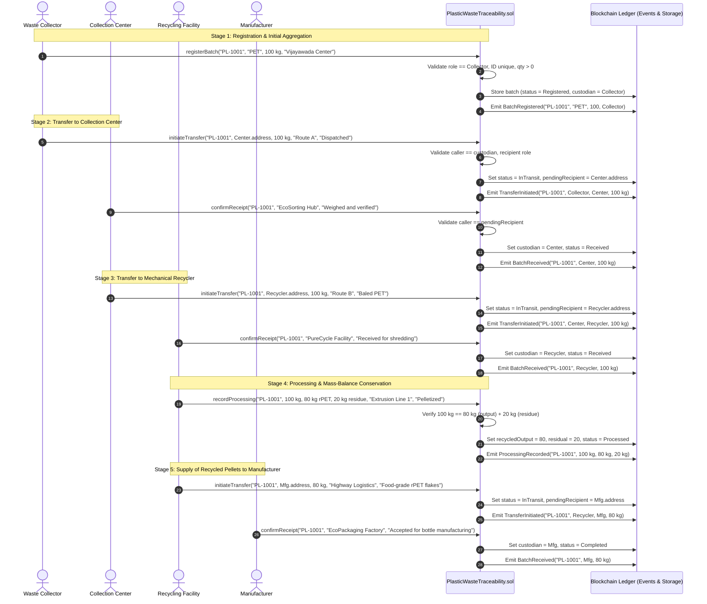
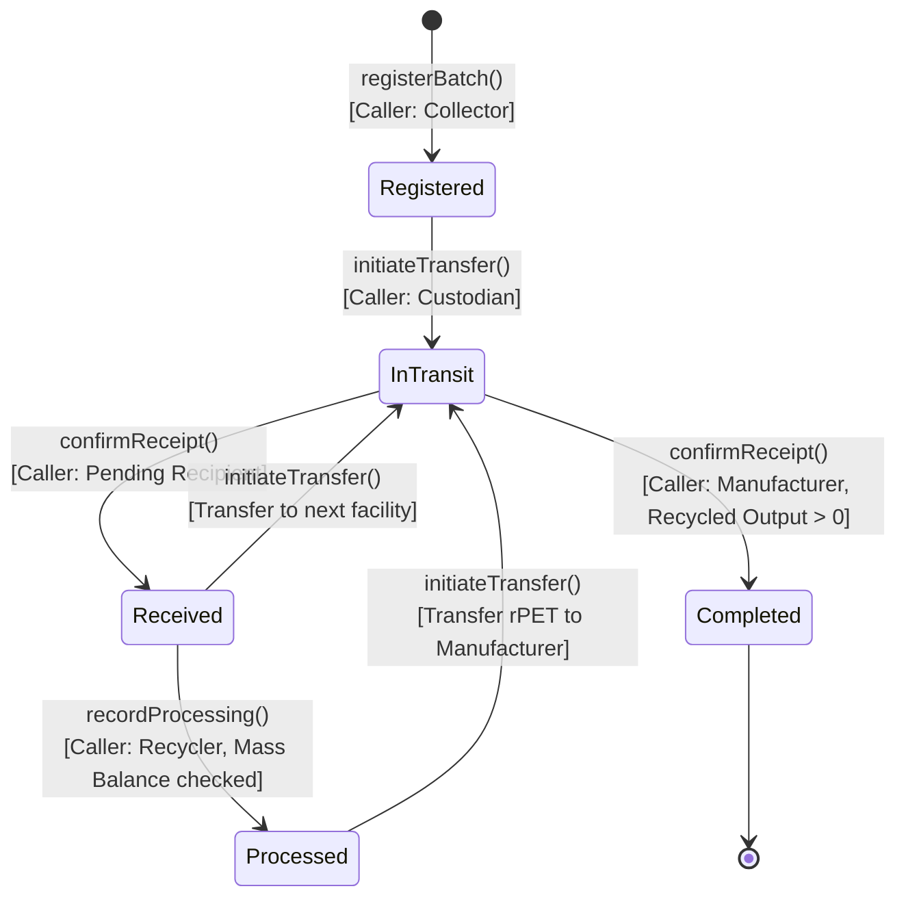

# PlasticTrace — System Diagrams & Visual Models

## 1. System Architecture Diagram

---

## 2. End-to-End Batch Lifecycle Sequence Diagram

---

## 3. Finite State Machine (Batch State Transitions)

